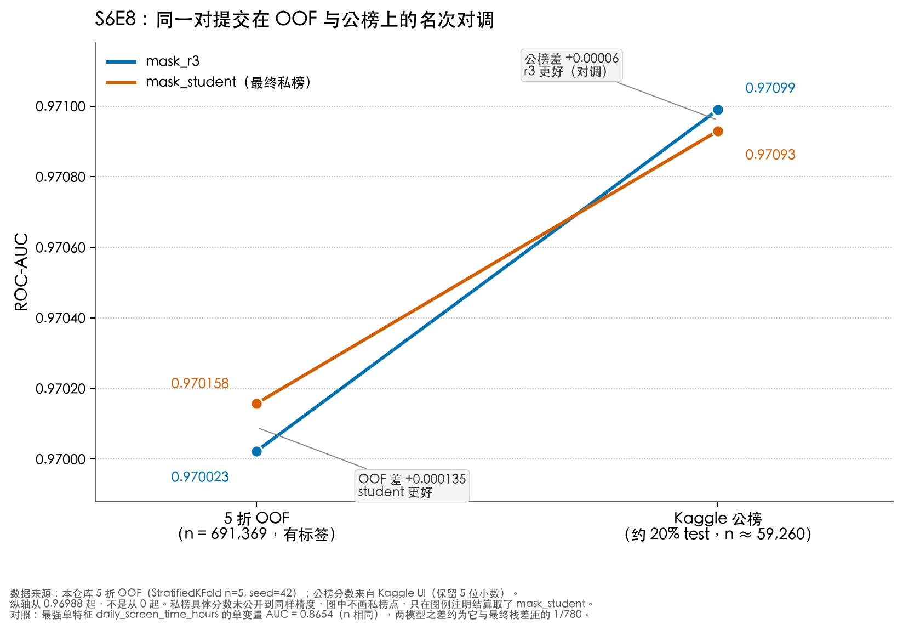

# 图表点评：OOF 与公榜的名次对调

图文件：`oof_vs_public_rank_flip.png`（中文） / `oof_vs_public_rank_flip_en.png`（英文）  
比赛：Kaggle Playground S6E8 Predicting Smartphone Addiction  
指标：ROC-AUC（越高越好）

---

## （1）这张图想表达什么？

它想说的不是「谁的 AUC 数字更大」，而是：**同一对几乎相同的提交，在两种评价上排反了。**

- 左轴是我们自己算的 5 折 OOF（691,369 行有标签，`StratifiedKFold(n=5, seed=42)`）。这里 **mask_student（0.970158）比 mask_r3（0.970023）高 0.000135**。
- 右轴是 Kaggle 公榜（大约 20% 的 test，约 59,260 行）。这里 **mask_r3（0.97099）反而比 mask_student（0.97093）高 0.00006**。
- 两条线交叉，表示名次对调。图例写明结算（私榜）取了 mask_student，和左边 OOF 同序，和右边公榜相反。

一句话：公榜在小数点后第 5 位已经分不清谁更好；样本大得多的 OOF 给出的方向，后来和私榜一致。

---

## （2）你觉得它表达得好不好？为什么？

**交叉这件事表达得好，幅度这件事表达得夸张。**

斜率图（slope chart）适合「两个对象、两个场合、名次是否对调」。交叉本身就是论点，不必再扫柱状图。左右都标了样本量和「有没有标签」，读者能看到：左边是 69 万带标签的折外预测，右边是大约 6 万行、且我们看不到标签的公榜切片。差值也写在框里，不用自己做减法。

不好的地方在于纵轴从 0.96988 起，不是从 0 或 0.5 起。这样交叉才看得见，但 0.00006 和 0.000135 被拉成了「两条大斜线」。视觉上像发生了剧烈反转；实际上两份提交的相关约 0.99985，公榜差只到 Kaggle 显示精度的最后一位。图在讲「排序反了」，没有同时讲「反转的幅度可以忽略不计」。脚注补了「最强单特征 AUC = 0.8654，两模型之差大约是它到最终栈差距的 1/780」，但这是文字，不是图，很多人不会读。

所以：作为「不要迷信公榜」的论点图，清楚；作为「这两份模型差多少」的幅度图，偏戏剧化。

---

## （3）数据呈现得公平客观吗？有没有误导？

数字来源是诚实的，呈现不完全中性。

**做得公平的地方**

- OOF 和公榜分开标，没有把两种评价画成同一条「进步曲线」。
- 公榜只保留 Kaggle UI 的 5 位小数，没有假装和 OOF 一样精密。
- 脚注写明纵轴截断、私榜具体分数没有画上去（我们没有同等精度的私榜数字，就不编）。
- 左轴写了「有标签」，右轴写了「约 20%」，避免读者以为两边是同一种检验。

**会误导的地方**

1. **截断纵轴。** 从 0.96988 到 0.97118，只展示了完整 AUC 尺度的约 0.13%。两条线看起来分得很开，其实都挤在 0.970 附近。
2. **连线不像时间，看起来像时间。** 从左到右容易读成「模型后来变差了 / 变好了」。其实是同一份预测在两套评价上的得分，不是训练过程。
3. **只画了两份提交。** 没有第三份对照（例如只做 135 列的 R0，OOF 约 0.9697），读者无法判断这 0.0001 在我们自己的配方梯子上算不算一步。
4. **没有误差。** 公榜约 6 万行、AUC 贴在 0.971，抽样误差完全可能吞掉 0.00006。图上两个点画成确定值，没有区间，看起来像「公榜确实证明 r3 更好」。
5. **私榜只出现在图例里。** 「最终私榜」四个字会让人以为橙色线已经被私榜验证为全面更好。我们只知道结算选了 student，不知道私榜高了多少。把未知的幅度写成图例里的确定身份，略过满。
6. **1/780 这个对照。** 用「单特征 0.8654 → 栈 0.970」当尺子，方向对，但尺子和被量的东西不是同一决策：竞赛里大家比的就是 0.0001，不是和单特征的距离。这句话压低了竞赛内差异的重要性。

---

## （4）你觉得这张图容易看懂吗？为什么？

**对做过这题的人容易，对外行人要停一下。**

容易的部分：两个模型、两个点、颜色分开、交叉一眼能看出来「左边谁高、右边谁高」。标题已经点名「名次对调」，不必自己总结。坐标轴写的是评价场景和样本量，不是模糊的「Before / After」。

费劲的部分：

- ROC-AUC 对非机器学习读者不直观，0.970 和 0.971 看起来几乎一样，必须先接受「这里只看小数点后第 4–5 位」。
- 左轴标签比右轴长，而且一个是交叉验证、一个是线上排行榜，概念不同。
- 两个灰色说明框和四组数字叠在一起，第一眼会先找交叉，再回头读框。
- 脚注三行密度高，是给要核查的人看的，不是扫图就能吸收的。

如果读者已经知道「公榜 20%、私榜 80%」，这张图 10 秒能读完；如果没有这个背景，需要先读标题和轴标签。

---

## （5）你会怎么改进它的设计？

1. **加一个从 0.50 到 1.00 的小插图**（或并排第二幅）。主图保留放大后的交叉，插图让人看到两条线其实贴在一起。现在只靠脚注说明截断，不够。
2. **给公榜点加不确定性。** 至少用文字或误差条标出：在 n ≈ 59,260、AUC ≈ 0.971 时，0.00006 落在噪声里。OOF 一侧 n 大两个数量级，可以画得更「实」。
3. **不要用从左到右的实线暗示过程。** 改成两端对齐的哑铃图（dumbbell），中间只画浅虚线，并在图上写「同一份预测，两种评价」，避免读成时间趋势。
4. **私榜要么有数字再画第三列，要么从图例拿掉「最终私榜」。** 改成图下一句：「竞赛结束后，Kaggle 在我们选中的两份里取了私榜更高的 mask_student。」身份和测量分开。
5. **加一个对照点。** 例如最强单特征 0.8654（只放在插图），或 R3 的 OOF 0.969950。读者才能把 0.000135 放回「配方梯子」而不是只看这两份互掐。
6. **减少图内文字。** 差值保留一个，样本量只放轴上，脚注只留数据来源和「纵轴截断」一句。1/780 那种修辞放到这篇点评里，不放进图。

改进后的核心仍然是交叉，但读者应同时看到三件事：排序反了、幅度极小、公榜这一侧更吵。
